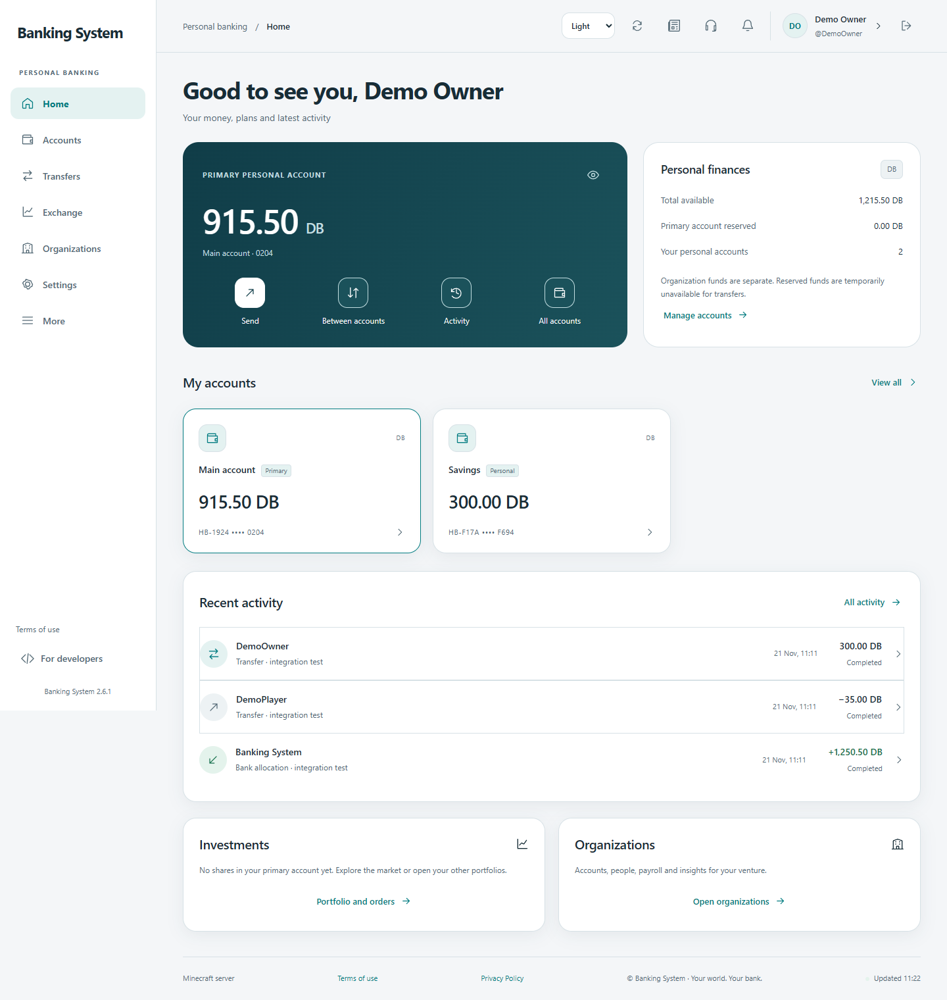
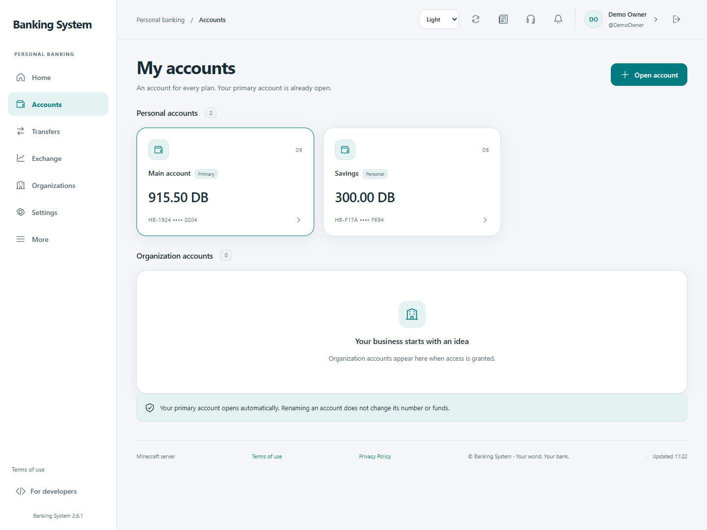
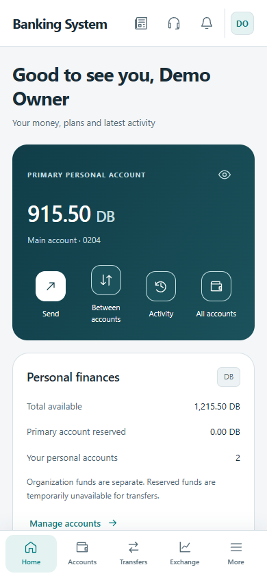
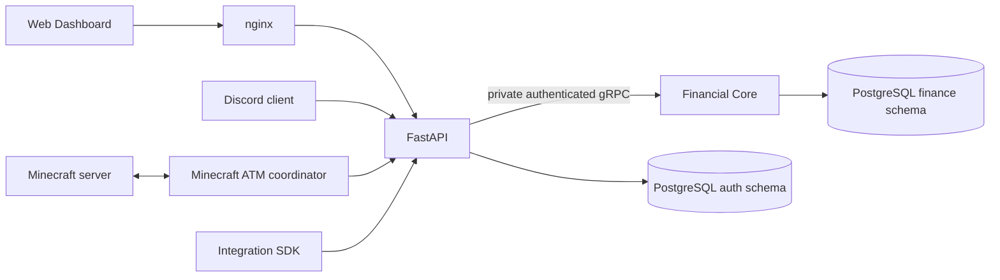

# Minecraft Banking System

A banking simulation for a Minecraft multiplayer server, built around a C++ financial core, PostgreSQL, a Python API, and a React web dashboard.

The system manages **fictional in-game currency** backed by the server's ancient-debris economy. Virtual accounts, payments, payroll, and shares are game mechanics. **This project is not a real financial institution and does not handle real money.**

This portfolio edition preserves the original system's service boundaries and financial implementation. Its display name, example configuration, and demonstration data use neutral terminology. Internal identifiers such as `horizon`, existing environment-variable names, and database roles remain for compatibility. The descriptive project name has not undergone a trademark-clearance review. This is an independent project, not an official Minecraft or Microsoft product.

## Features

- Personal virtual accounts, account history, saved recipients, transfer confirmations, and receipts.
- Organizations with account permissions, payment requests, product catalogs, analytics, and payroll.
- A virtual stock exchange with IPOs, limit orders, bounded market orders, portfolios, and dividends.
- Password authentication, optional Discord OAuth2, persistent sessions, and scoped integration keys.
- Administrative roles, separate financial authorities, audit trails, support tickets, and bank news.
- Minecraft account verification and optional Mineflayer ATMs for deposits and withdrawals.
- HPay purchases through private Minecraft messages and an optional Fabric client for Minecraft **1.21.11**.
- Russian, English, and Ukrainian UI localization, responsive layouts, and light/dark themes.

The application remains multilingual. Repository documentation and the API guide are in English.

## Screenshots

These screenshots come from a local demonstration with freshly generated, fictional users and ledger transactions. They contain no production accounts or player data.







## Technology

| Component | Implementation |
| --- | --- |
| Financial Core | C++20, gRPC, Protocol Buffers, libpqxx |
| Persistence | PostgreSQL 16, independent `finance` and `auth` migration streams |
| API | Python 3.12+, FastAPI, SQLAlchemy, Argon2id, Alembic |
| Web Dashboard | React 19, TypeScript, Vite, existing localization catalog |
| Integrations | Discord client, Mineflayer ATMs, Python SDK |
| Optional game client | Java 21, Fabric, Minecraft 1.21.11 |
| Deployment | Docker Compose and nginx |

## Architecture



The API authenticates users and integrations. The Financial Core independently checks debit permissions and executes transactions. The API database role cannot write the financial schema. The schemas normally share one PostgreSQL server; they are separate ownership boundaries, not two unrelated balance stores.

Money is passed as decimal strings and parsed into integer cents. Financial changes use database transactions, idempotency records, paired ledger entries, and reconciliation constraints. These controls are described in [Financial model](docs/financial-model.md); they are not a claim of formal verification or suitability for real-money banking.

## Local development

Install Docker Engine with Compose v2 and Python 3.12 or later. From this repository:

```bash
python tools/create_dev_env.py
docker compose -f docker-compose.yml -f docker-compose.dev.yml up -d --build
```

Open **http://localhost:8080** and register a local test user. The API guide is at **http://localhost:8080/api/docs**. Discord and Minecraft credentials are optional and are not supplied by this repository. New accounts start without virtual funds; registering does not mint currency.

The environment helper refuses to overwrite an existing `.env` and generates independent local secrets. Never copy its local development configuration to a production service. See [Local development](docs/local-development.md) for native dependencies, synthetic demo data, optional integrations, and cleanup boundaries.

For the isolated screenshot/demo environment, build the native core and frontend, configure a **dedicated local PostgreSQL test server**, and run `python tools/demo.py`. That tool creates a new `horizon_test_*` database; it does not import an existing database. See [Testing](docs/testing.md).

## Security

The repository includes regression tests for authorization, idempotency, concurrent financial requests, exact balances, and database-role separation. Public HTTP access should go through the reverse proxy. PostgreSQL, gRPC, and internal service endpoints must remain private.

This is an educational portfolio project. A local audit and passing tests do not establish that the entire system is vulnerability-free, compliant, or ready for an unreviewed deployment. Game integrations also rely on the configured Minecraft server and external identity providers. See [Security policy](SECURITY.md), [Deployment](docs/deployment.md), and [Operational boundaries](docs/operations.md).

Detailed private security findings and operational credentials are deliberately excluded from this repository. Report security issues privately; do not attach real player data to public issues.

## Development & AI Transparency

### AI-Assisted Development (Vibe Coding)

Minecraft Banking System was developed with extensive assistance from AI coding tools, including OpenAI Codex.

The maintainer's role has included defining the product vision, specifying requirements and workflows, directing development, testing functionality, reporting issues, and making decisions about the system.

A substantial portion of the source code was generated or modified with AI assistance. The maintainer does not claim to have written all of the code manually. This project represents experience in product specification, AI-assisted development, testing, and coordinating a complex software project. Generated code still requires review, testing, and ongoing maintenance.

## Repository guide

| Location | Purpose |
| --- | --- |
| `core/` | Financial Core and protobuf contract |
| `backend/` | Authentication, authorization, REST API, auth migrations |
| `database/finance/` | Financial schema and integrity migrations |
| `frontend/` | Multilingual Web Dashboard |
| `atm/` | Minecraft ATM coordinator and chat formatting |
| `bot/` | Discord client and notification delivery |
| `minecraft-mod/hpay/` | Optional Fabric payment shortcut client |
| `sdk/` | Typed Python integration client |
| `tests/` | Unit, integration, security, and isolated database checks |
| `tools/` | Local development and publication checks |
| `docs/` | Current English technical documentation |

Start with [Architecture](docs/architecture.md), [API](docs/api.md), [Configuration](docs/configuration.md), [Minecraft integrations](docs/minecraft-atm.md), and [HPay](docs/hpay.md).

## License

This portfolio release is distributed under the **Apache License 2.0**, selected by the project owner. See [LICENSE](LICENSE), [NOTICE](NOTICE), and [third-party notices](docs/third-party-notices.md). Original MIT notices are retained for code previously distributed under those terms. Dependencies and game resources retain their own licenses.

No game binaries, production databases, credentials, private Git history, or original production logo are included. See [Publication checklist](docs/publication.md) before creating any public remote repository.
